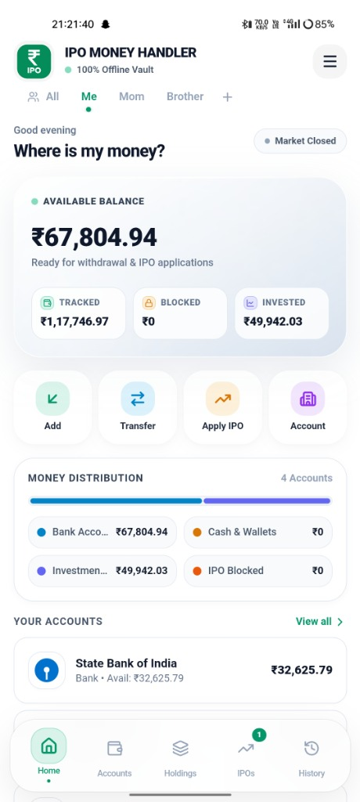
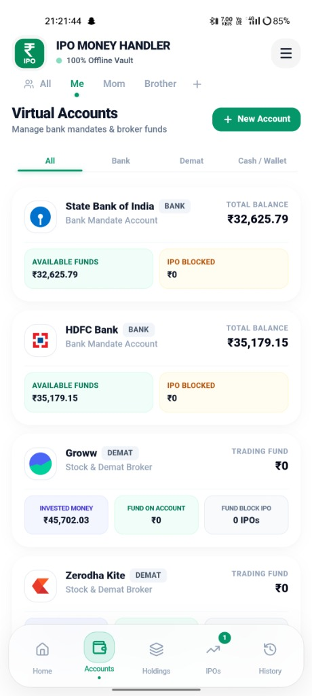
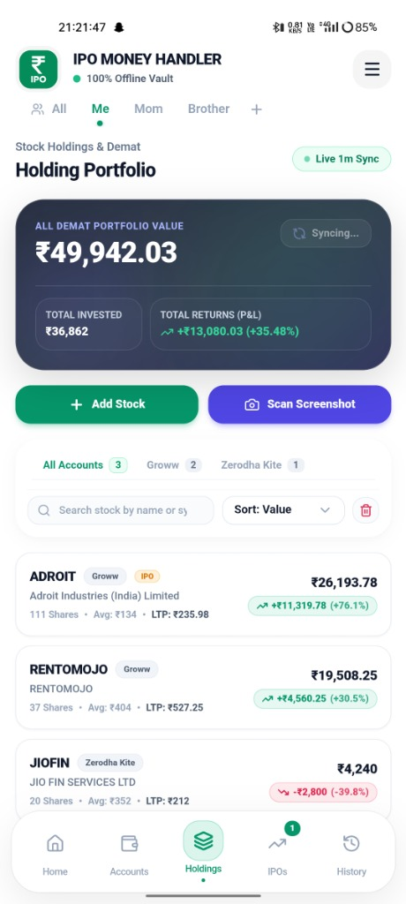
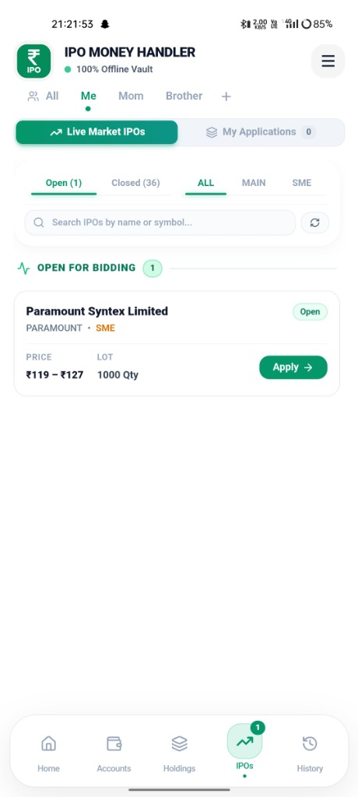
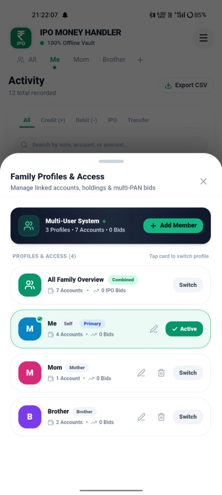
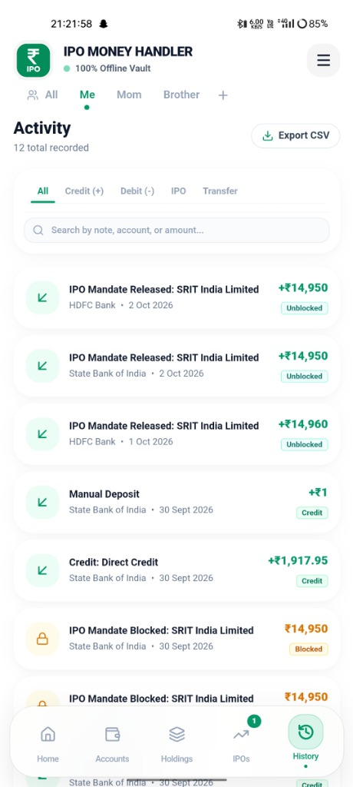
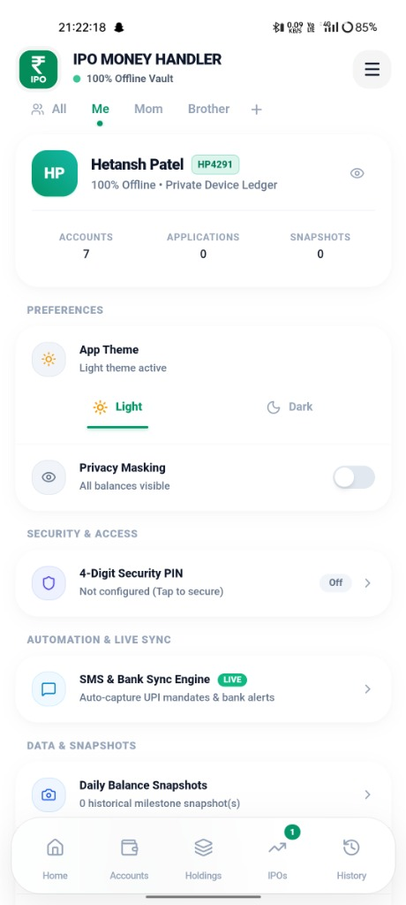

# 📊 IPO Money Handler

[](LICENSE)
[](https://nextjs.org/)
[](https://react.dev/)
[](https://www.typescriptlang.org/)
[](https://capacitorjs.com/)
[](https://tailwindcss.com/)

> **Comprehensive financial management application designed for tracking, managing, and calculating IPO application investments across multiple family and Demat accounts.**

---

## 📸 Screenshots

| 🏠 Home Dashboard | 💳 Demat & Family Accounts |
| :---: | :---: |
|  |  |

| 📈 All Accounts Holdings | ⚡ Live Market & IPO Verification |
| :---: | :---: |
|  |  |

<details>
<summary><b>🔍 View Additional Screenshots</b></summary>

| 👥 Family Profile Scope | 📜 Application History | ⚙️ Settings & Theme |
| :---: | :---: | :---: |
|  |  |  |

</details>

---

## ✨ Key Features

- **Multi-Profile & Family Demat Scoping**: Manage multiple family members and broker Demat accounts (Zerodha, Groww, AngelOne, Upstox, ICICI Direct, HDFC Sky, Kotak Neo, etc.) under unified or segregated profiles.
- **Combined Holdings & Accounts View**: Toggle between a specific profile and the global "All Accounts" view to get a bird's-eye view of your entire portfolio.
- **Fund Blocking & Release Tracker**: Instantly calculate blocked ASBA/UPI funds, allotment probability, returns, and real-time net worth impact.
- **Intelligent Demat OCR Scanner**: Auto-detect brokers, lot multipliers, and application numbers directly from screenshots or camera capture.
- **Live Market Verification**: Real-time Grey Market Premium (GMP) updates, subscription rates, issue dates, and allotment timelines.
- **Profit & Loss Analytics**: Comprehensive historical analytics with offline JSON backup, CSV exports, and detailed report generation.
- **Modern Mobile Native UX**: 120fps smooth spring dismiss bottom sheets, edge-to-edge transparent status bar, and adaptive theme switching.

---

## 🛠 Tech Stack

- **Framework**: [Next.js 15](https://nextjs.org/) (App Router, Static Export)
- **Frontend**: [React 19](https://react.dev/) & [TypeScript](https://www.typescriptlang.org/)
- **Mobile Runtime**: [Capacitor 8](https://capacitorjs.com/) (Android Bridge)
- **State Management**: [Zustand](https://github.com/pmndrs/zustand) (Persistent Local Store)
- **Styling**: [Tailwind CSS](https://tailwindcss.com/)
- **Icons & Animation**: [Lucide React](https://lucide.dev/) & Canvas Confetti

---

## 🚀 Getting Started

### Prerequisites

- **Node.js**: v18+ (Node 20+ recommended)
- **npm** or **yarn** / **pnpm**
- **Android Studio** (for building Android APK / running on device)

### Installation

1. **Clone the repository**:
   ```bash
   git clone https://github.com/hetansh21-pro/IPOMoneyHandler.git
   cd IPOMoneyHandler
   ```

2. **Install dependencies**:
   ```bash
   npm install
   ```

3. **Start local development server**:
   ```bash
   npm run dev
   ```
   Open [http://localhost:3000](http://localhost:3000) in your browser.

4. **Build web export**:
   ```bash
   npm run build
   ```

### 📱 Android Build (Capacitor)

1. **Sync with Android**:
   ```bash
   npx cap sync android
   ```

2. **Open in Android Studio**:
   ```bash
   npx cap open android
   ```

3. Run on your physical Android device or emulator to generate the debug/release APK.

---

## 📖 About the Project

For an in-depth breakdown of the project architecture, design decisions, and data flows, see [**ABOUT.md**](ABOUT.md).

---

## 👤 Author

**Hetansh Patel**
- GitHub: [@hetansh21-pro](https://github.com/hetansh21-pro)
